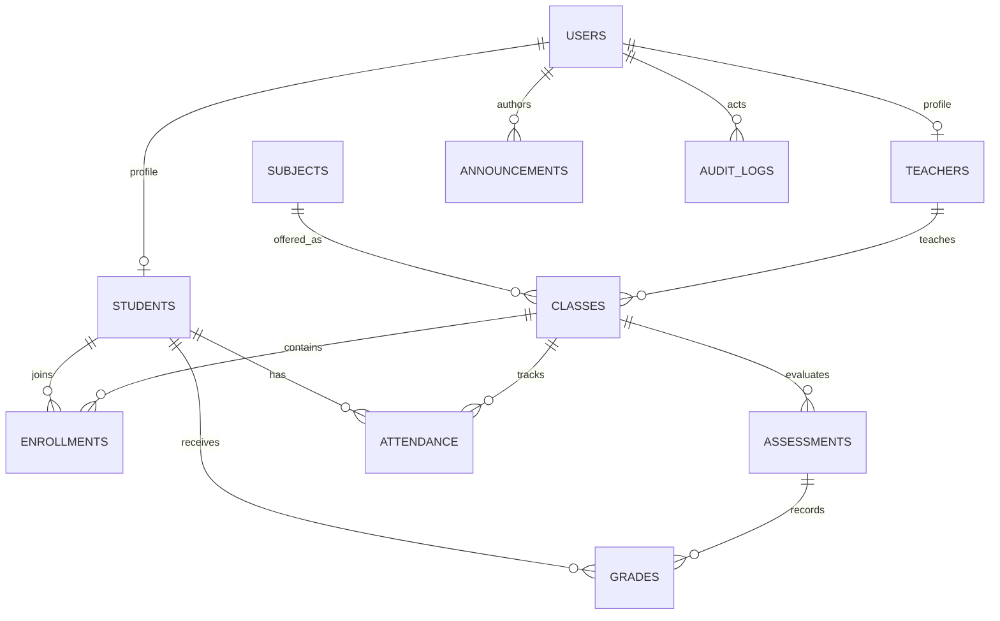

# EduTrack — Sistema de Gestão Acadêmica

EduTrack é uma aplicação de portfólio para organizar alunos, professores, disciplinas, turmas e rotinas acadêmicas. Administradores gerenciam os cadastros, professores trabalham apenas nas próprias turmas e alunos acompanham somente seus dados acadêmicos.

## Funcionalidades implementadas

- Página pública do produto, autenticação, encerramento de sessão e orientação de recuperação de acesso.
- Painéis com indicadores consultados no PostgreSQL.
- Cadastro e consulta de alunos, professores, disciplinas e turmas.
- Matrículas sem duplicação.
- Avaliações e notas ponderadas; o servidor rejeita notas acima do valor máximo.
- Registro e consulta de frequência; um registro por aluno, turma e data.
- Avisos segmentados por perfil.
- Relatórios de notas e frequência.
- Consulta administrativa de auditoria.
- Sessões server-side em PostgreSQL, cookies `HttpOnly`, validação de origem, rate limits para login e escrita, cabeçalhos Helmet e senhas Argon2/bcrypt-compatíveis via bcryptjs.
- Contrato OpenAPI 3.1 e interface Swagger.
- Seed fictício idempotente, ativo somente fora de produção.

## Stack e arquitetura

- **Interface:** React, TypeScript, Vite, TanStack Query, Wouter, Tailwind CSS e componentes Radix/shadcn.
- **Servidor:** Node.js, Express 5 e TypeScript.
- **Dados:** PostgreSQL e Drizzle ORM.
- **Contrato/validação:** OpenAPI 3.1, Orval e Zod.
- **Testes:** Node test runner com `tsx`, cobrindo funções de cálculo e fluxos HTTP integrados.

O workspace fornecido no Replit usa Drizzle e uma API Express compartilhada; por compatibilidade, o projeto mantém essa arquitetura em vez de trocar para Prisma ou criar um segundo servidor. O contrato em `lib/api-spec/openapi.yaml` é a fonte para os clientes e schemas gerados.

### Estrutura

```text
artifacts/edutrack/                 Interface React
artifacts/api-server/src/routes/    Rotas REST e autenticação
artifacts/api-server/src/lib/       Regras, cálculos e seed
lib/api-spec/openapi.yaml           Contrato da API
lib/api-client-react/               Hooks React Query gerados
lib/api-zod/                        Schemas Zod gerados
lib/db/src/schema/                  Esquema relacional Drizzle
lib/db/drizzle/                     Migrações SQL versionadas
```

## Banco de dados e migrações

O projeto utiliza o PostgreSQL fornecido pelo ambiente Replit por meio de `DATABASE_URL`. A configuração local deve conter também `SESSION_SECRET`, com ao menos 32 caracteres.

```sh
cp .env.example .env
pnpm install
pnpm --filter @workspace/db run generate  # cria migração a partir do esquema atual
pnpm --filter @workspace/db run push      # aplica esquema no banco de desenvolvimento
pnpm --filter @workspace/api-server run dev
```

`push` é para o banco de desenvolvimento do projeto. A migração SQL versionada gerada fica em `lib/db/drizzle/`. Revise e mantenha esse arquivo junto com cada alteração estrutural; não edite um banco de produção manualmente.

## Contas de demonstração

Na execução de desenvolvimento, o servidor cria dados fictícios se as contas EduTrack de demonstração ainda não existirem. O seed pode ser executado mais de uma vez sem duplicar esses dados. A rotina sai imediatamente em `NODE_ENV=production`.

| Perfil | E-mail |
|---|---|
| Administrador | `admin@edutrack.demo` |
| Professor | `rafael@edutrack.demo` |
| Professora | `camila@edutrack.demo` |
| Aluno | `aluno001@edutrack.demo` |

Senha de desenvolvimento para essas quatro contas: `EduTrack@2026`. Não reutilize essa senha fora do ambiente local/de demonstração.

## Executar e testar

Os workflows do projeto iniciam a interface e a API. Com o ambiente configurado, também é possível executar:

```sh
pnpm --filter @workspace/api-server run dev
pnpm --filter @workspace/edutrack run dev
pnpm --filter @workspace/api-server run typecheck
pnpm --filter @workspace/edutrack run typecheck
pnpm --filter @workspace/api-server run test
pnpm --filter @workspace/api-spec run codegen
pnpm run typecheck
```

A suíte atual verifica sessão, login válido/inválido, endpoints anônimos, isolamento de perfis, restrição de turmas do professor, matrícula e frequência duplicadas, nota acima do limite, atualização persistida de nota, auditoria, cálculos de média/frequência e contrato OpenAPI. Para rodá-la, o PostgreSQL e `SESSION_SECRET` precisam estar disponíveis.

## API e documentação

- Swagger UI: `/api/docs`
- Documento JSON: `/api/openapi.json`
- Documento YAML: `/api/openapi.yaml`

Rotas cobertas pelo contrato: autenticação, dashboards, alunos, professores, disciplinas, turmas, matrículas, avaliações, notas, frequência, avisos, relatórios e auditoria.

## Modelo relacional



O banco garante unicidade de e-mail, matrícula, inscrição em turma, nota por avaliação/aluno e frequência por aluno/turma/data. A associação entre aluno matriculado e avaliação é validada na transação da API.

## Segurança verificada

- Senhas demonstrativas são armazenadas como hash bcrypt com fator 12, nunca como texto puro.
- O identificador de sessão é aleatório e opaco; os dados ficam no banco. O cookie é `HttpOnly`, `SameSite=Lax`, limitado a `/api`, e `Secure` em produção.
- As rotas autenticadas conferem o perfil e o vínculo do usuário no servidor; esconder links no frontend não é tratado como autorização.
- Leitura de notas e frequência de aluno filtra pelo vínculo autenticado. A consulta de turma de professor só inclui turmas atribuídas.
- Entradas são validadas com Zod, as consultas usam parâmetros Drizzle e erros internos não são enviados ao cliente.
- Logs HTTP removem query string e não registram corpo, senha, cookie ou cabeçalhos de autenticação.
- Rate limit de login: 8 tentativas por IP a cada 15 minutos. Requisições de escrita têm limite geral por IP.
- Os testes executados exercitam os fluxos declarados acima; eles não constituem auditoria externa nem certificação de segurança.

## Limitações conhecidas e próximos passos

- Recuperação de senha por e-mail ainda não está configurada; a tela informa que a conta deve ser recuperada pelo administrador, sem alegar envio de mensagem.
- Cadastros centrais oferecem criação e consulta; fluxos de edição/desativação dos perfis, disciplinas e turmas ainda precisam de rotas e telas específicas.
- O calendário acadêmico não possui uma entidade de eventos independente; o painel mostra avaliações futuras e avisos.
- Não há comando de provisionamento inicial do administrador de produção; como a seed é bloqueada em produção, configure esse fluxo antes de aceitar contas reais.
- Ajuste a política de origem permitida e a estratégia de rate limit ao domínio e à topologia de produção antes de abrir o sistema publicamente.
- Faça testes adicionais com usuários institucionais, política acadêmica real, acessibilidade assistida e volume representativo antes de uso operacional.

## GitHub e publicação

1. Revise `.gitignore` e confirme que `.env` e quaisquer segredos não estão no commit.
2. Conecte o projeto a um repositório GitHub pelo controle de versão do Replit; mantenha o lockfile, migrações e documentação versionados.
3. Configure `SESSION_SECRET` no gerenciador de Secrets do ambiente publicado. `DATABASE_URL` é fornecido pelo banco do projeto.
4. Publique pela ação **Publish** do Replit após verificar as mudanças de esquema propostas. A seed de demonstração não executa em produção.
5. Use contas próprias de produção; as contas e a senha de demonstração não são criadas no ambiente publicado.
